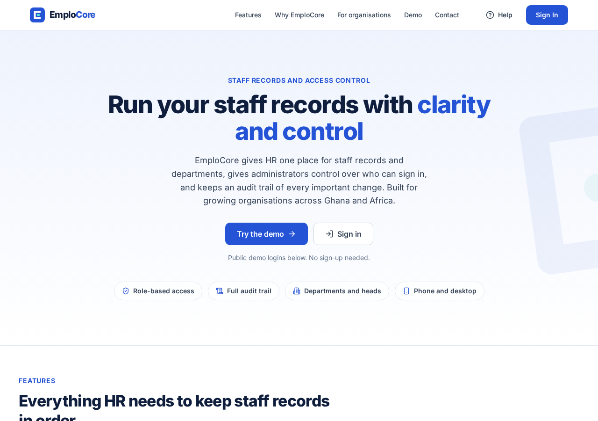
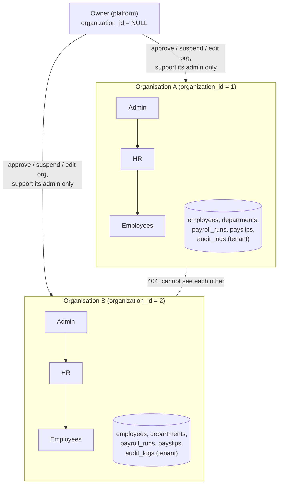

# 1. Overview

## What EmploCore is

EmploCore is a web application for managing a company's people: user accounts and roles, employee
records, departments, and monthly payroll with Ghana PAYE and SSNIT. It is a **multi-tenant SaaS**
product: one deployment serves many client organisations, and each organisation only ever sees
its own data.

- Live app: `https://emplocore.vercel.app` (React single-page app on Vercel)
- API: a Node.js/Express service on Render (`/api/*`)
- Database: MySQL 8 on Aiven, reached over TLS

The public deployment is also a **demo**: it contains one sample organisation, "EmploCore Demo",
with three protected demo logins (admin, HR and employee) that visitors can try.

## Who uses it

| Role | Belongs to | What they do |
|---|---|---|
| **Owner** (platform owner, "super admin") | No organisation (`organization_id` is `NULL`) | Runs the platform: approves or rejects new organisations, suspends and reactivates them, edits plan and seat limit, supports each organisation's **admin** accounts, reads demo requests (*Enquiries*) and the platform-level audit log. Never sees an organisation's HR or employee accounts. |
| **Admin** (organisation admin) | One organisation | Manages the organisation's user accounts (create, change role, deactivate, reset passwords, delete), reads the organisation's full audit log, and can do everything HR can do. |
| **HR** | One organisation | Manages employee records, departments and payroll (pay details, payroll runs, publishing payslips). Can create *employee* accounts and link them to employee records. No audit-log access. |
| **Employee** | One organisation | Sees and edits their own profile, sees the employment record HR linked to their account, views and downloads their own **published** payslips, changes their password. |

The roles are defined in `config/roles.js` (`ROLES = ['employee', 'hr', 'admin']`, plus
`OWNER_ROLE = 'owner'`, which is deliberately not one of the assignable organisation roles).

## How an organisation joins

1. Someone fills in **Register your organisation** (`/register-organisation`). This creates the
   organisation with status `pending` and its first admin account.
2. The admin cannot sign in yet ("waiting for approval").
3. The owner approves it in the owner console. The status becomes `active`.
4. The admin signs in, creates HR accounts, and HR sets up departments, employees and payroll.

The owner can also create an organisation directly (it starts `active`, and the admin gets a
temporary password shown once).

## The multi-tenant model

All organisations share one database. Every tenant-owned row carries an `organization_id`, and
every query filters on the signed-in user's organisation, which is loaded from the database on each
request (never from the browser). A record that belongs to another organisation behaves as if it
did not exist: the API answers **404**. Everything below runs in one deployment with one MySQL
database.

Key points:

- **One database, many tenants.** Isolation is enforced in code (every model method takes the
  organisation id) and checked by `tests/tenancy.test.js`, `tests/payroll.test.js` and others.
- **Organisation status gates sign-in.** Only `active` organisations can sign in. `pending`,
  `suspended` and `rejected` organisations get a clear message and no token, and existing tokens stop
  working on the next request.
- **The owner has a support boundary.** The owner sees organisation details, the admin account(s),
  and head counts by role, but not HR or employee names or e-mails (see
  [Security and tenancy](06-security-and-tenancy.md)).
