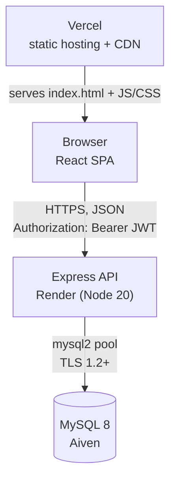
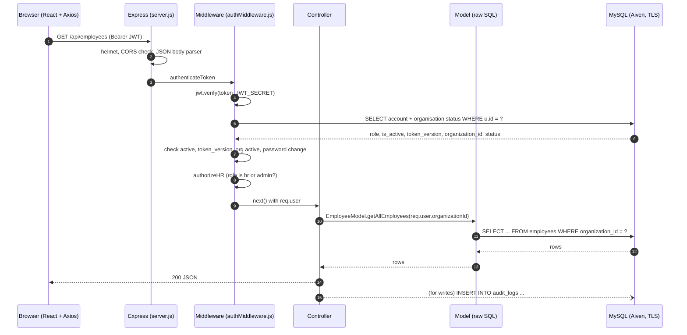
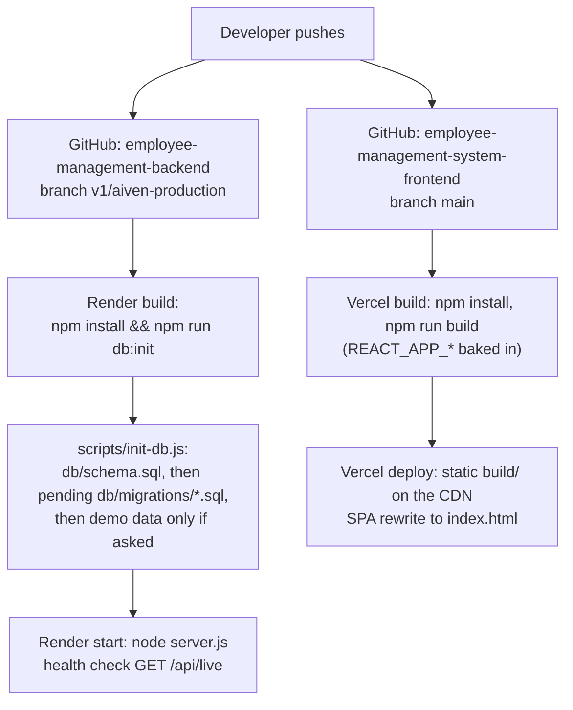

# 2. Architecture

## The three parts

### Frontend (repository `employee-management-system-frontend`, branch `main`)

- **Create React App 5** (`react-scripts`) with **React 19**.
- **React Router 7** for pages. Every path lives in `src/routes/paths.js`; the route table is
  `src/routes/AppRoutes.js`; `src/routes/PrivateRoute.js` guards pages by role.
- **Axios** through one shared client, `src/api/client.js`. It sets the base URL
  (`REACT_APP_API_URL`, default the Render URL), a 60-second timeout (free hosting can take about a
  minute to wake), attaches the JWT from `localStorage`, sends the user to `/login` on a 401, and to
  `/account/password` when the API says `PASSWORD_CHANGE_REQUIRED`.
- Small libraries only: `react-hot-toast` (notifications), `lucide-react` (icons), `jwt-decode`
  (reads the token's expiry in the browser).
- No UI framework: styling is plain CSS with design tokens (`src/styles/tokens.css`).
- Hosted on **Vercel**. `vercel.json` runs `npm run build`, serves `build/`, and rewrites every path
  to `index.html` so deep links work in a single-page app.

### Backend (repository `employee-management-backend`, branch `v1/aiven-production`)

- **Node.js 20** and **Express 5** (`server.js`).
- **mysql2** with raw, parameterised SQL. No ORM.
- `jsonwebtoken` (JWT sessions), `bcryptjs` (password hashes), `helmet` (security headers),
  `cors` (allow-list), `express-rate-limit` (brute-force limits), `express-validator` (input
  checks), `pdfkit` + `@fontsource/inter` (payslip PDFs).
- Hosted on **Render** as a web service (`render.yaml` documents the settings). Health check path:
  `/api/live`.

### Database

- **MySQL 8** on **Aiven**, over TLS. `config/dbConfig.js` builds the connection from `DB_URL` and
  turns TLS on when the URL says `ssl-mode=REQUIRED` or a CA certificate is supplied
  (`DB_SSL_CA`, `DB_SSL_CA_BASE64` or `DB_SSL_CA_PATH`). Certificates are verified unless
  `DB_SSL_REJECT_UNAUTHORIZED=false` (not recommended). Minimum TLS version 1.2.
- One connection **pool** (`config/db.js`), size `DB_CONNECTION_LIMIT` (default 5), with keep-alive.
  If MySQL is down at start-up the server keeps running and retries with back-off; `/api/health`
  reports `503` until the database is reachable.
- Connections use `utf8mb4` and UTC (`timezone: 'Z'`).

## Request lifecycle

Every authenticated call goes through the same steps:

1. The React page calls `api.get('/api/...')`. The Axios interceptor adds `Authorization: Bearer <token>`.
2. Express applies, in order: `helmet()`, `cors(corsOptions)`, `express.json({ limit: '100kb' })`.
3. The router for that path runs its middleware chain, for example
   `authenticateToken` → `authorizeHR` → (validation) → controller.
4. `authenticateToken` verifies the JWT signature and expiry, then **loads the account from the
   database** (role, `is_active`, `token_version`, organisation and its status). A mismatch means 401.
   The loaded account becomes `req.user`, including `req.user.organizationId`.
5. The role guard (`authorizeAdmin`, `authorizeHR`, `authorizeOwner`) returns 403 if the role is wrong.
6. The controller validates the body, calls a model, and the model runs parameterised SQL with
   `req.user.organizationId` in the `WHERE` clause.
7. The controller returns JSON. Important actions also write an audit entry
   (`AuditLogModel.insertLog`), usually after the response is sent.

Errors follow a small set of shapes: `{ error }` (most errors), `{ errors: [...] }` (validation from
`express-validator`), and `{ error, code }` when the frontend needs to react to a specific case
(e.g. `ORGANISATION_SUSPENDED`, `PASSWORD_CHANGE_REQUIRED`, `DEMO_ACCOUNT_PROTECTED`,
`SEAT_LIMIT_REACHED`). Unknown `/api` paths return `404 { error: 'Not found' }` and invalid JSON
returns `400`.

## Deploy pipeline

- **Backend:** a push to `v1/aiven-production` triggers a Render deploy. The build command runs
  `npm run db:init`, which applies the schema and any **pending migrations** before the new code
  starts. If a migration fails, the build fails and the previous version keeps serving traffic.
  A deploy takes about a minute.
- **Frontend:** a push to `main` triggers a Vercel production deploy. Other branches get Vercel
  preview URLs (`emplocore-*.vercel.app`), which the API's default CORS list already allows.
- **Order matters** when a change touches both: deploy the backend first (new endpoints and columns),
  then the frontend that uses them.
- `REACT_APP_*` variables are read **at build time**. Change them in Vercel, then redeploy.
