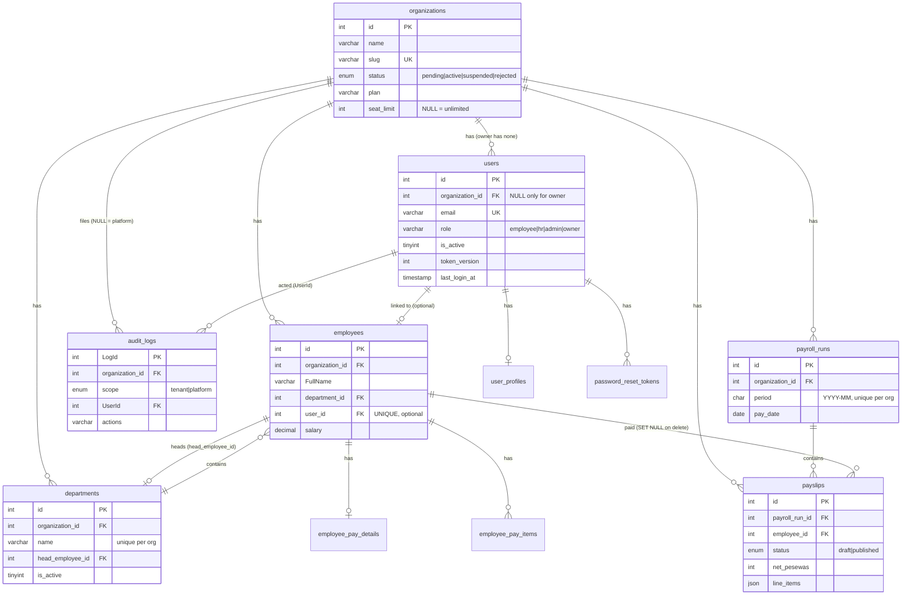

# 4. Data model

All tables are InnoDB, `utf8mb4`, with foreign keys. Money is stored in whole **pesewas**
(integers). Times are stored in UTC.

## Entity relationships

`enquiries` and `schema_migrations` stand alone (no foreign keys).

## Tables

### `organizations` (tenants; migrations 005, 006)

| Column | Meaning |
|---|---|
| `id`, `name`, `slug` | Identity. `slug` is unique and URL-safe (`config/slug.js`) |
| `status` | `pending` (awaiting approval, no sign-in), `active`, `suspended` (sign-in and sessions refused, data kept), `rejected` (registration declined) |
| `plan`, `seat_limit` | Commercial fields. `seat_limit` = maximum **active** user accounts (`NULL` = no limit); enforced when accounts are created or reactivated (`SEAT_LIMIT_REACHED`, 409). `plan` mirrors the subscription's plan (`organization_subscriptions.plan_code`, migration 009) |
| `contact_email`, `contact_name`, `phone`, `org_type`, `size_range`, `country`, `city` | Sign-up details (006) |
| `rejection_reason`, `reviewed_at`, `approved_at` | Owner review |
| `created_at`, `updated_at` | Timestamps |

### `users` (accounts; schema + 001, 005, 008)

| Column | Meaning |
|---|---|
| `organization_id` | The tenant. `NULL` only for the owner: the check `chk_users_org_role` requires `(role = 'owner') = (organization_id IS NULL)` |
| `username`, `email` | Display name and login. **E-mail is unique across the whole platform**, because login is by e-mail |
| `password` | bcrypt hash |
| `role` | `employee`, `hr`, `admin` or `owner` |
| `is_active` | 0 = deactivated: login and existing tokens are refused |
| `token_version` | Bumped on logout, password change, role change and deactivation. Tokens carrying an older version are refused, which is how sessions are revoked server-side |
| `must_change_password`, `password_changed_at` | Temporary-password flow |
| `last_login_at` | Last successful sign-in (008) |

### `user_profiles`

Optional personal details per account (`first_name`, `last_name`, `phone`, `address`). One row per
user (`UNIQUE user_id`), removed with the user.

### `employees` (employee records; schema + 003, 004, 005)

`FullName`, `email` (unique **per organisation**), `phone`, `position`, `salary` (DECIMAL, GHS: the
headline salary; saving pay details keeps it equal to the basic salary), `department_id`, and
`Department` (a read-only copy of the department name kept for older readers), plus `user_id`, the
optional link to the person's login (one account per record).

An employee **record** (HR data) and a user **account** (login) are separate on purpose: some
staff never sign in, and HR can link them later.

### `departments` (004, 005)

`name` (unique per organisation, case-insensitive), `description`, `head_employee_id` (must be a
member; cleared if that employee is deleted), `is_active` (deactivated departments keep members but
accept no new ones). A department can only be deleted when it has no employees.

### `audit_logs` (schema + 005, 008)

`LogId`, `organization_id` (`NULL` = platform-level event), `scope` (`tenant` or `platform`),
`UserId` (the actor, `SET NULL` if deleted), `actions` (e.g. `LOGIN`, `CREATE_EMPLOYEE`,
`RUN_PAYROLL`), `descriptions` (max 255 characters), `created_at`. Indexed by organisation and time,
and by scope and time.

### `password_reset_tokens` (002)

One-time links an admin generates. Only the **SHA-256 hash** of the token is stored, with
`expires_at` (`RESET_LINK_TTL_MINUTES`, default 60), `used_at` and `created_by`. A newer link
invalidates older ones.

### `enquiries` (006)

"Request a demo" submissions: `name`, `organization_name`, `email`, `phone`, `message`, `status`
(`new`, `contacted`, `closed`), `contacted_at`. Platform-level: not tied to an organisation.

### Payroll tables (007)

| Table | Purpose |
|---|---|
| `employee_pay_details` | Current pay set-up per employee (primary key `employee_id`): `basic_salary_pesewas`, `currency` (GHS), optional `bank_name`, `bank_account`, `ssnit_number`, `updated_by` |
| `employee_pay_items` | Named monthly lines: `kind` = `allowance` (taxable, added to gross) or `deduction` (after tax, e.g. a loan), `amount_pesewas`, `sort_order` |
| `payroll_runs` | One per organisation and month (`period` `YYYY-MM`, unique per organisation, checked by a regex constraint), with `pay_date` |
| `payslips` | One per employee and month: a **snapshot** of the employee details, every amount (`basic_pesewas` ... `net_pesewas`, `ssnit_employer_pesewas`) and, in `line_items` (JSON), the allowance and deduction lines, the PAYE bands used and the rules applied. `status` `draft` -> `published`. `reference` is unique (e.g. `PS-202609-4K7Q2M`). If the employee record is deleted, `employee_id` becomes `NULL` and the payslip stays |

### Subscription and billing tables (009)

| Table | Purpose |
|---|---|
| `plans` | The price list (primary key `code`: `free`, `starter`, `growth`, `business`, `enterprise`): monthly and yearly price, employees included, extra-employee price (pesewas), admin/HR limits, feature flags (`feature_payroll`, `feature_audit_log`, `feature_priority_support`), public feature list, display flags. Edited by the owner |
| `organization_subscriptions` | One row per organisation (primary key `organization_id`): `plan_code`, `status` (`trialing`/`active`/`grace`/`free`), `billing_mode` (`paystack`/`manual`/`exempt`), interval, trial/period/grace dates, Paystack customer, plan and subscription codes, amount, discount, owner overrides (`employee_limit_override`, `manual_monthly_pesewas`, `manual_until`, `note`). `organizations.plan` mirrors `plan_code` for older code |
| `billing_checkouts` | Each Paystack checkout started by an admin (unique `reference`), with the quoted amount; becomes `success` once verified |
| `billing_payments` | Every payment attempt and renewal (unique `reference`); successful ones get an `invoice_number` `EC-YYYY-NNNNNN` |
| `billing_events` | Webhook events by unique `event_key` (idempotency), with a sanitised payload (no card authorisation codes) and processing result |
| `billing_coupons`, `billing_coupon_redemptions` | The founding offer (`FOUNDING40`) with its place limit, and which organisation redeemed it until when |
| `billing_notices` | In-app notices (trial ending, payment failed, grace…) with a unique `dedupe_key` so the daily job never repeats one |
| `billing_job_runs` | One row per daily job run with a summary |

### `schema_migrations`

The name of every applied migration file and when it ran. `scripts/migrate.js` uses it to apply each
file exactly once.

## Migrations 001–010

Migrations live in `db/migrations/` and run in filename order on every deploy (only the new ones).
They are forward-only: there are no "down" scripts.

| # | File | What it does and why |
|---|---|---|
| 001 | `001_users_account_status.sql` | Adds `is_active`, `token_version`, `must_change_password`, `password_changed_at` to `users`: deactivation, server-side session revocation and forced password changes |
| 002 | `002_password_reset_tokens.sql` | Creates `password_reset_tokens`. There is no e-mail service, so an admin generates a one-time link and hands it over; only its hash is stored |
| 003 | `003_employees_user_link.sql` | Adds `employees.user_id` (unique, `SET NULL` on account delete) so an employee can see their own record |
| 004 | `004_departments.sql` | Turns free-text department names into real `departments` rows (case- and space-insensitive), links every employee via `department_id`, keeps `Department` as a copy |
| 005 | `005_organizations.sql` | **Multi-tenancy.** Creates `organizations`; adds `organization_id` to users (nullable, owner only), employees, departments and audit logs; makes e-mail and department names unique per organisation; moves all existing data into one "EmploCore Demo" organisation (only if there was data) |
| 006 | `006_org_signup_details_enquiries.sql` | Adds the `rejected` status and sign-up details (type, size, country, city, phone, contact, rejection reason, `reviewed_at`); creates `enquiries` |
| 007 | `007_payroll.sql` | Creates `employee_pay_details`, `employee_pay_items`, `payroll_runs`, `payslips` (all money in pesewas; payslips are snapshots) |
| 008 | `008_audit_scope_last_login.sql` | Adds `audit_logs.scope` (`tenant`/`platform`) and backfills it from the action name and whether an owner acted; adds `users.last_login_at`, backfilled from past `LOGIN` entries |
| 010 | `010_billing_owner_controls.sql` | Adds the `paused` subscription status and `paused_at`, `paused_from` (owner pause and resume) |
| 009 | `009_subscriptions.sql` | Creates the subscription and billing tables above; seeds the five plans and the `FOUNDING40` coupon; gives the demo organisation Growth (exempt), active and suspended organisations a 30-day Growth trial, and pending registrations a trial that starts on approval; `organizations.plan` defaults to `growth` |

`tests/migrations.test.js` builds a populated v1 database, runs every migration, checks that no
data was lost and that a second run does nothing.

### Writing a new migration

1. Add `db/migrations/011_short_name.sql`. Never edit a migration that has already run in production.
2. Prefer additive changes (new tables, nullable columns, new indexes), so the previous code version
   still works if you need to roll back.
3. If you add a table, add it to the drop lists in `tests/helpers.js` and `scripts/init-db.js`.
4. Extend `tests/migrations.test.js` (the expected file list, plus a check of your backfill).
5. Run `npm test` locally, then push. Render applies it in the build step.
