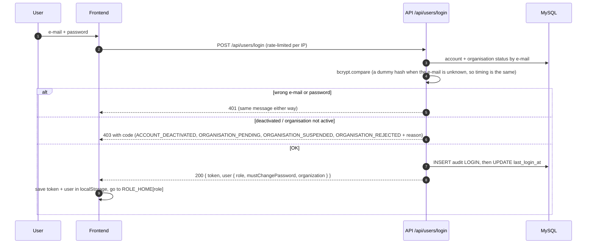

# 6. Security and tenancy

## Authentication flow

After login, every request is checked by `authenticateToken` (see
[Architecture](02-architecture.md#request-lifecycle)): signature and expiry, then a database reload
of role, `is_active`, `token_version` and organisation status. So:

- **Logout** (`POST /api/users/logout`) bumps `token_version`: every token of that account stops working.
- **Password change, role change, deactivation** also bump it.
- **Suspending an organisation** blocks its users on their next request (401 with
  `ORGANISATION_SUSPENDED`; the frontend shows a notice on the sign-in page).
- **Temporary password:** while `must_change_password` is set, only `/api/users/change-password`,
  `/api/users/logout` and `/api/users/me` work; everything else returns 403
  `PASSWORD_CHANGE_REQUIRED`.
- **No e-mail service.** Password resets are done by an admin (or, for admins, by the owner): either a
  temporary password shown once, or a one-time reset link (`POST /api/users/reset-password` with the
  token; only its SHA-256 hash is stored; expires after `RESET_LINK_TTL_MINUTES`, default 60).

## Roles and permissions

`authorizeHR` lets HR **and** admins through; `authorizeAdmin` admins only; `authorizeOwner` the
owner only. The owner is refused by the organisation guards.

| Capability (API) | Owner | Admin | HR | Employee | Public |
|---|:-:|:-:|:-:|:-:|:-:|
| Sign in, `/api/users/me`, change own password, logout | ✓ | ✓ | ✓ | ✓ | sign in only |
| Own profile (`/api/users/profile`), own employee record (`/me/employee`) | – | ✓ | ✓ | ✓ | – |
| Own published payslips (`/api/payroll/my-payslips`) | – | ✓ | ✓ | ✓ | – |
| Employee records CRUD, link accounts (`/api/employees`) | – | ✓ | ✓ | – | – |
| Departments (`/api/departments`) | – | ✓ | ✓ | – | – |
| Payroll: pay details, runs, publish, all payslips | – | ✓ | ✓ | – | – |
| Create accounts (`POST /api/users/register`) | – | any role | employee only | – | – (403 `SELF_SIGNUP_CLOSED`) |
| List, re-role, activate/deactivate, reset, delete users | – | ✓ (own org) | – | – | – |
| Organisation audit log (`/api/audit-logs`, `/recent`) | – | ✓ (own org, all scopes) | 403 | 403 | – |
| Billing: plan, payments, invoices, checkout, cancel (`/api/billing`) | – | ✓ (own org) | 403 | 403 | – |
| Plan status for banners (`GET /api/billing/status`) | – | ✓ | ✓ | ✓ | – |
| Plans and prices (`GET /api/billing/plans`) | ✓ | ✓ | ✓ | ✓ | ✓ |
| Register an organisation (`POST /api/organizations/register`) | – | – | – | – | ✓ (pending) |
| Request a demo (`POST /api/enquiries`) | – | – | – | – | ✓ |
| Owner console (`/api/platform/*`) | ✓ | 403 | 403 | 403 | 401 |
| Support an org's **admins** (status, temp password, reset link) | ✓ | – | – | – | – |
| See HR/employee names or e-mails of an organisation | ✗ (404) | ✓ (own org) | ✓ (own org) | – | – |

The profile and my-payslips routes only require a valid token. The owner has no organisation, so for
the owner they return nothing useful, and the owner console does not use them.

Extra rules inside those permissions:

- An admin cannot change their own role, deactivate or delete themselves.
- Accounts are always created in the creator's own organisation; seat limits apply.
- An organisation can only be deleted by the owner when it has no users or employee records (a
  pending or rejected **registration** without employee records is deleted together with its
  sign-up account).
- Draft payslips can be deleted; published ones cannot (409).
- Employees only ever see their **own published** payslips; anything else is 404.

## Tenant isolation

- `req.user.organizationId` comes from the database on every request, never from the token payload
  or the request body.
- Every organisation-scoped model method takes the organisation id and puts it in the `WHERE` clause.
- Another organisation's record is **404**, exactly like a missing record.
- `tests/tenancy.test.js` creates a second organisation and checks every list and every `/:id`
  route for leaks; `tests/payroll.test.js` does the same for payroll.

### The owner's boundary

The owner console API returns, per organisation: organisation details, `admins` (name, e-mail,
status, last sign-in) and `user_counts` (`{ admin|hr|employee: { active, inactive } }`). It never
returns HR or employee names or e-mails. The support routes are `/api/platform/admins/:id/status`,
`/temporary-password` and `/reset-link`; `requireOrgAdminTarget` answers 404 unless the target is an
organisation admin. There is no impersonation.

## Rate limits (`config/rateLimits.js`, per IP, in memory)

| Limiter | Applies to | Default | Env vars |
|---|---|---|---|
| `authLimiter` | `POST /api/users/login`, `/register`, `/reset-password` | 10 per 15 minutes | `AUTH_RATE_LIMIT_MAX`, `AUTH_RATE_LIMIT_WINDOW_MIN` |
| `orgSignupLimiter` | `POST /api/organizations/register`, `POST /api/platform/bootstrap-owner` | 5 per 60 minutes | `ORG_SIGNUP_RATE_LIMIT_MAX`, `ORG_SIGNUP_RATE_LIMIT_WINDOW_MIN` |
| `enquiryLimiter` | `POST /api/enquiries` | 5 per 60 minutes | `ENQUIRY_RATE_LIMIT_MAX`, `ENQUIRY_RATE_LIMIT_WINDOW_MIN` |

Over the limit the API returns **429** with a friendly message and standard `RateLimit` headers.
`trust proxy` is set to 1 so the client IP is read correctly behind Render. The counters live in the
process memory: they reset when the service restarts or redeploys, and would not be shared across
several instances (see [Scalability](08-scalability.md)).

## HTTP hardening

- `helmet()` sets its default security headers; `tests/api.test.js` checks `X-Content-Type-Options: nosniff`
  and `Strict-Transport-Security`.
- **CORS allow-list** (`config/cors.js`, `ALLOWED_ORIGINS`): disallowed origins get no CORS
  headers (the browser blocks them); requests without an `Origin` (curl, health checks) are allowed.
  Only `GET, POST, PUT, DELETE, OPTIONS` and the headers `Content-Type`, `Authorization`.
- **Body size** limited to 100 KB; invalid JSON is a clean 400.
- **Honeypot** on the enquiry form: a filled hidden `website` field is rejected.

## Validation

- `validator/userValidator.js` and `validator/employeeValidator.js` (express-validator): name
  lengths, e-mail format and uniqueness (users: platform-wide; employees: per organisation), roles,
  salary.
- Controllers validate everything else by hand, for example the sign-up form (fixed lists from
  `config/signupOptions.js`, phone format), plans (`/^[a-z0-9][a-z0-9 _-]{0,39}$/i`), seat limits
  (whole number ≥ 1 or empty), pay amounts (up to 2 decimals, converted to pesewas), and payroll
  periods (`YYYY-MM`, not later than next month).
- All SQL uses placeholders; `tests/api.test.js` includes SQL-injection attempts treated as data.

## Password rules (`config/roles.js`)

| Accounts | Rules |
|---|---|
| Organisation users | At least 8 characters, at most 72 bytes (bcrypt's limit), at least one letter and one number |
| Owner | At least 12 characters, at most 72 bytes, a letter and a number, at least 6 different characters, must not contain the e-mail name |

Hashes: bcrypt cost 10 for organisation users, 12 for the owner. Temporary passwords are random
(`crypto.randomBytes`) and must be changed at the next sign-in.

## Billing and payments

- **Webhook** `POST /api/billing/paystack/webhook` is mounted before the JSON parser so the **raw
  body** can be checked: `x-paystack-signature` must equal HMAC SHA-512 of the raw body with
  `PAYSTACK_SECRET_KEY` (compared in constant time). Otherwise 401. Without a key, 503.
- **Idempotent**: each event is stored once in `billing_events` by a unique key; repeats are ignored.
  Stored payloads drop card authorisation codes.
- **Server-side verification**: a plan is only activated after `GET /transaction/verify` with
  Paystack confirms success, the expected amount and currency GHS, for a checkout reference that
  belongs to the same organisation. The callback page cannot activate anything by itself.
- **Tenant isolation**: billing queries always use the signed-in admin's `organization_id`;
  invoices and payments of another organisation return 404. Only admins manage billing.
- **Plan limits** (`middleware/planGuards.js`, `OrganizationModel.lockSeat`): creating employees over
  the cap → 409 `PLAN_LIMIT_REACHED`; editing records while over the cap → 409 `PLAN_OVER_LIMIT`;
  payroll changes and the audit log on a plan without them → 403 `PLAN_FEATURE_UNAVAILABLE`; extra
  admin/HR accounts → 409 `PLAN_LIMIT_REACHED`. Data is never deleted.
- **Owner actions** on subscriptions are logged with `scope = platform`; the exempt demo organisation
  refuses them (403 `BILLING_EXEMPT`).
- Paystack keys are environment variables only (never in the repository or the frontend).

## Audit logging

- `AuditLogModel.insertLog({ userId, organizationId?, actions, descriptions })` writes an entry.
  Without `organizationId`, the actor's organisation is used.
- Logged today, among others: `LOGIN`, `LOGOUT`, `CHANGE_PASSWORD`, `REGISTER_USER`,
  `UPDATE_USER_ROLE`, `ACTIVATE_USER`/`DEACTIVATE_USER`, `ADMIN_PASSWORD`, `RESET_LINK_CREATED`,
  `RESET_PASSWORD`, `DELETE_USER`, employee and department changes (`CREATE_EMPLOYEE`,
  `LINK_EMPLOYEE_USER`, `SET_DEPARTMENT_HEAD`, ...), payroll (`SET_PAY_DETAILS`, `RUN_PAYROLL`,
  `PUBLISH_PAYSLIPS`, `DELETE_PAYSLIP`), organisation events (`REGISTER_ORGANIZATION`,
  `APPROVE_ORGANIZATION`, `SUSPEND_ORGANIZATION`, ...), enquiries and owner account changes.
- **Who reads what** (scope, migration 008):

| Reader | Sees |
|---|---|
| Owner (`/api/platform/audit-logs`) | `platform` entries only: owner actions and organisation-level events |
| Organisation admin (`/api/audit-logs`) | Every entry filed under their organisation, whatever its scope |
| HR, employee | Nothing (403) |

- The old test-only `POST /api/audit-logs` route is disabled unless `ENABLE_AUDIT_LOG_TEST_ROUTE=true`,
  so nobody can forge entries in production.

## Demo mode

- Backend: `DEMO_MODE` (`true`/`false`/unset = automatic) and `DEMO_PROTECTED_EMAILS` (defaults to the
  three demo logins). Protection blocks delete, deactivate, re-role, password change or reset, and
  unlinking for those accounts (403 `DEMO_ACCOUNT_PROTECTED`), and blocks suspending the demo
  organisation (`DEMO_ORGANISATION_PROTECTED`).
- Frontend: `REACT_APP_DEMO_MODE` shows the demo logins on the landing and sign-in pages.
- The public deployment runs in demo mode. A real deployment sets both to `false`
  ([PRODUCTION.md](../PRODUCTION.md)).

## What is protected where

| Concern | Where it is enforced |
|---|---|
| Who you are | JWT signature and expiry + account reload (`middleware/authMiddleware.js`) |
| What role may call a route | `authorizeOwner` / `authorizeAdmin` / `authorizeHR` in `routes/*.js` |
| Which organisation's data | Model methods with `organizationId` (`models/*.js`) |
| Owner limited to admins | `PlatformController.requireOrgAdminTarget`, `OrganizationModel.admins/userCounts` |
| Audit visibility | `auditLogRoute.js` (admin only), `AuditLogModel.listPlatform` (`scope = 'platform'`) |
| Demo accounts | `config/demoAccounts.js` checks inside the user, employee and payroll controllers |
| Brute force | `config/rateLimits.js` |
| Pages in the browser | `PrivateRoute.js` (convenience only; the API is the real gate) |
| Secrets | Environment variables only; `.env` is git-ignored; `.env.example` has placeholders |
