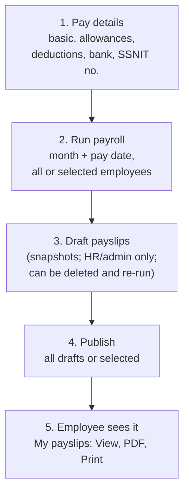
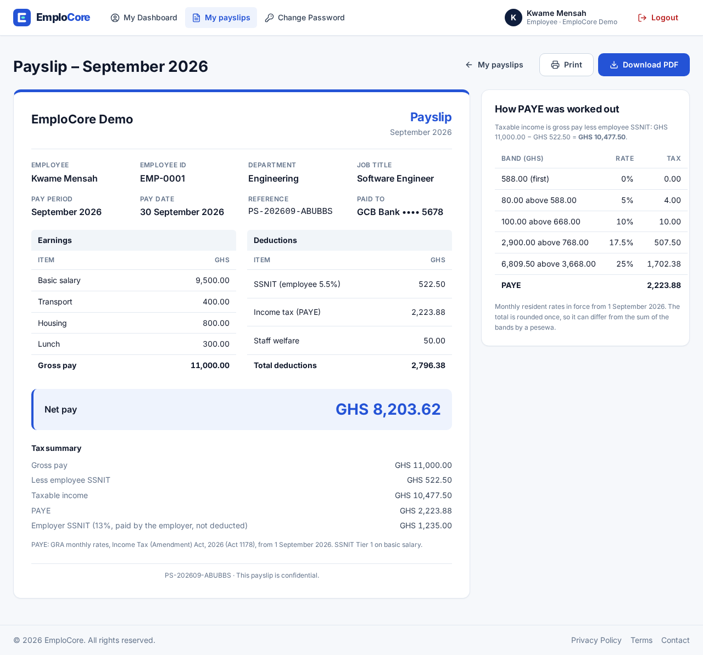
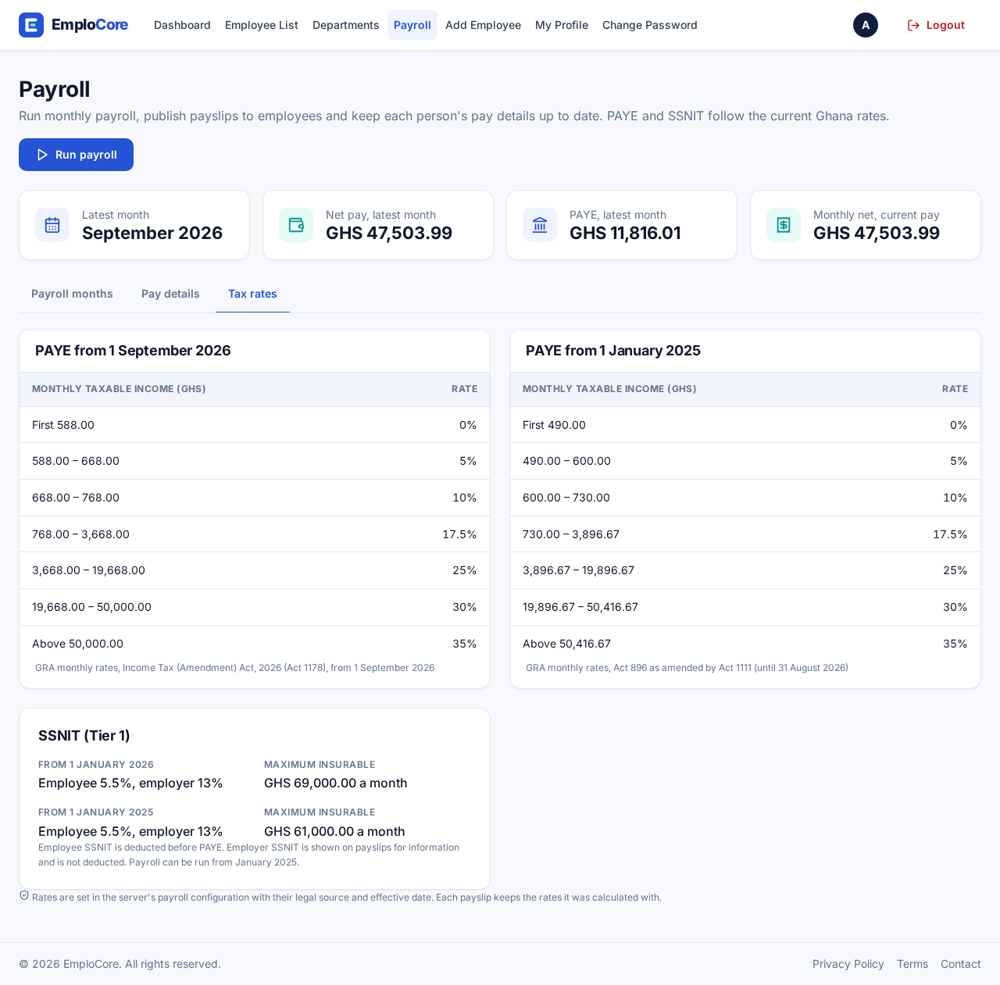

# 7. Payroll (Ghana PAYE and SSNIT)

## The flow



1. **Pay details** (HR → Payroll → *Pay details* → Edit): basic salary, named allowances and other
   deductions (up to 20 each), bank name and account, SSNIT number. The form shows a live net-pay
   preview (`POST /api/payroll/preview`, nothing saved). Saving also sets `employees.salary`.
2. **Run payroll** (`POST /api/payroll/runs`): a month (`YYYY-MM`, at most next month) and a pay date.
   It creates **draft** payslips for every employee, or only the selected ones. Employees who already
   have a payslip for that month are skipped; employees without a salary are left out and listed.
3. **Review** the month (`/hr/payroll/2026-09`): totals for gross, PAYE, SSNIT and net; open any payslip.
   A wrong draft can be deleted and the run repeated for that person.
4. **Publish** all drafts or selected ones. Published payslips are final.
5. The employee sees published payslips under **My payslips**, and can download the server-made PDF
   or print.

## The calculation (`services/payrollCalc.js`)

All amounts are whole pesewas; rates are basis points. Rounding: half up, once.

```
gross            = basic + allowances
employee SSNIT   = 5.5% of basic (basic capped at the maximum insurable earnings)
taxable income   = gross - employee SSNIT
PAYE             = graduated monthly bands applied to taxable income (summed exactly, rounded once)
net              = gross - employee SSNIT - PAYE - other deductions
employer SSNIT   = 13% of basic (same cap); shown for information, not deducted
```

The rule set is chosen per **period**: the newest entry whose `effectiveFrom` is on or before the
first day of that month. Periods before the earliest entry (January 2025) cannot be run.

### Bands in force from 1 September 2026 (Act 1178), monthly

| Chargeable income slice (GHS) | Rate |
|---|---|
| First 588.00 | 0% |
| Next 80.00 (to 668.00) | 5% |
| Next 100.00 (to 768.00) | 10% |
| Next 2,900.00 (to 3,668.00) | 17.5% |
| Next 16,000.00 (to 19,668.00) | 25% |
| Next 30,332.00 (to 50,000.00) | 30% |
| Above 50,000.00 | 35% |

SSNIT Tier 1 for 2026: employee 5.5%, employer 13%, maximum insurable earnings GHS 69,000 a month.

## Worked example

This is the demo employee Kwame Mensah's September 2026 payslip on the live demo. It was checked
by running `calculatePayslip` with the same inputs.

**Inputs:** basic GHS 9,500.00; allowances Transport 400.00, Housing 800.00, Lunch 300.00; other
deduction Staff welfare 50.00.

| Step | Working | GHS |
|---|---|---|
| Gross | 9,500.00 + 400.00 + 800.00 + 300.00 | **11,000.00** |
| Employee SSNIT | 5.5% × 9,500.00 (below the 69,000 cap) | **522.50** |
| Taxable income | 11,000.00 − 522.50 | **10,477.50** |
| PAYE band 1 | 588.00 × 0% | 0.00 |
| PAYE band 2 | 80.00 × 5% | 4.00 |
| PAYE band 3 | 100.00 × 10% | 10.00 |
| PAYE band 4 | 2,900.00 × 17.5% | 507.50 |
| PAYE band 5 | (10,477.50 − 3,668.00) = 6,809.50 × 25% | 1,702.375 → 1,702.38 |
| PAYE total | sum of exact slices, rounded once | **2,223.88** |
| Other deductions | Staff welfare | 50.00 |
| Net pay | 11,000.00 − 522.50 − 2,223.88 − 50.00 | **8,203.62** |
| Employer SSNIT (info) | 13% × 9,500.00 | 1,235.00 |

Because PAYE is rounded once on the exact total, it can differ by a pesewa from adding up the
rounded band figures. The payslip page says so under "How PAYE was worked out".



## Where the rules live

Everything is in **`config/ghanaPayroll.js`**, the one place to change rates:

- `PAYE_TABLES`: a list of `{ effectiveFrom, label, bands: [{ upTo, rateBp }] }`. `upTo` is the
  cumulative upper limit in pesewas (`null` = no limit); `rateBp` is the rate in basis points.
- `SSNIT_RULES`: a list of `{ effectiveFrom, employeeRateBp, employerRateBp, maxInsurablePesewas }`.
- Each entry has a comment naming its official source (GRA or SSNIT) and the date it was checked.

The HR **Tax rates** tab (`GET /api/payroll/tax-rules`) shows exactly what the server uses.



## Updating the rules each year

Every January SSNIT publishes the new maximum insurable earnings, and GRA can change the PAYE bands
(often with the budget). When that happens:

1. Find the official notice (gra.gov.gh, ssnit.org.gh). Note the effective date.
2. In `config/ghanaPayroll.js`, **add a new entry** at the top of the list with the new
   `effectiveFrom` (first day of the month it applies to). Never edit or delete old entries: past
   periods must keep computing the same way.
3. Convert GHS to pesewas (× 100) and percentages to basis points (× 100). PAYE `upTo` values are
   **cumulative** (add each "next X" slice to the previous limit).
4. Write the source URL and the date you checked it in the comment.
5. Add a hand-worked test in `tests/payrollCalc.test.js` for a period under the new rules (and keep
   the old tests passing).
6. `npm test`, push, and check HR → Payroll → *Tax rates* on the live site.

Existing payslips are unaffected: they are snapshots that store the bands and rules used.
