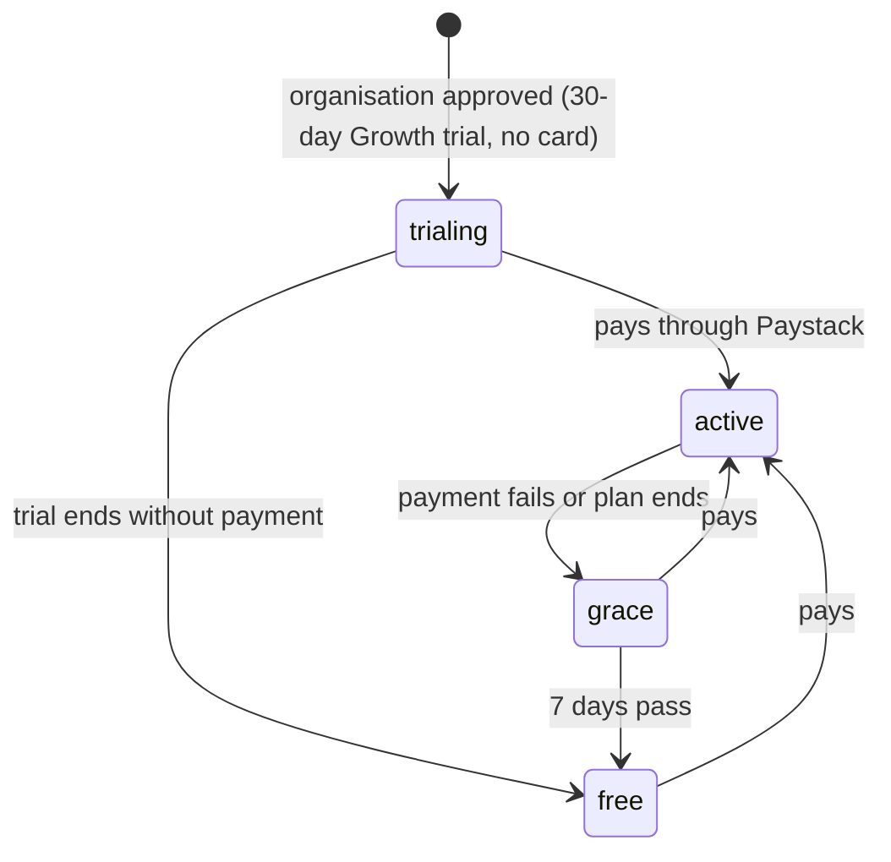

# 9. Subscriptions and billing (LIVE)

> **Status: LIVE. Paystack TEST keys are set (19 October 2026), so checkouts use test cards and take no
> real money; switch to live keys to charge customers.** Plans, trials,
> limits, the Billing page, the owner's plan and subscription tools and the daily job are all live.
> Until `PAYSTACK_SECRET_KEY` is set on Render, organisation admins see **"Payments coming soon,
> contact us"** and nothing else changes. Switching payments on is a configuration step, described in
> `docs/PAYSTACK_SETUP.md` and at the end of this chapter.

## Plans (seeded by migration 009, edited by the owner)

Prices live in the `plans` table, so the owner changes them on **Owner console → Plans and prices**
without a code change. Seeded values (from the approved pricing proposal):

| Plan | Monthly | Yearly | Employees included | Extra employee | Accounts | Features |
|---|---|---|---|---|---|---|
| Free | GHS 0 | – | 5 (hard limit) | – | 1 admin, no HR | Employee records, departments, roles. No payroll |
| Starter | GHS 99 | GHS 990 | 15 | GHS 6 a month | 1 admin + 1 HR | + Ghana payroll (PAYE, SSNIT), PDF payslips, My payslips |
| Growth | GHS 249 | GHS 2,490 | 50 | GHS 5 a month | unlimited HR | + organisation audit log, priority support |
| Business | GHS 549 | GHS 5,490 | 150 | GHS 4 a month | unlimited | + onboarding help |
| Enterprise | Custom | Custom | agreed | agreed | agreed | Set by the owner per organisation |

- Yearly prices are 10 × monthly. A yearly extra employee costs 10 × the monthly extra.
- Paid plans with an extra-employee price have **no hard cap**: extra employees are counted at each
  renewal and the Paystack plan amount is updated (`repriceExtras` in the daily job). Free and owner
  limits (`employee_limit_override`) are hard caps.
- Money is stored in **pesewas** (integers). All dates are UTC (= Accra time).

## Lifecycle

- Renewals keep an organisation `active`. The owner can also assign any plan, which sets
  `billing_mode = manual`.
- `status`: `trialing`, `active`, `grace`, `free`, `paused` (owner paused: Free entitlements, data kept). `billing_mode`: `paystack`, `manual` (owner
  assigned, e.g. Enterprise or a comp) or `exempt` (the demo organisation, Growth for ever).
- **No data is ever deleted.** On a lower plan, data over a limit is kept and readable:
  employee records over the cap can be viewed and deleted but not edited or added (`409
  PLAN_OVER_LIMIT` / `PLAN_LIMIT_REACHED`); payroll records stay viewable but new runs need Starter
  or above (`403 PLAN_FEATURE_UNAVAILABLE`); the audit log keeps recording but is only shown on
  Growth and above. Extra admin/HR accounts beyond a plan cannot be added or reactivated.
- A plan change starts a new billing period from the day of payment (no proration). "Cancel
  renewal" keeps the plan until the period end, then the grace period, then Free.
- Existing organisations got a fresh 30-day Growth trial when migration 009 ran; pending
  registrations start theirs on approval.

## Founding offer

Coupon `FOUNDING40`: 40% off for 12 months for the first 25 paying organisations. It is applied
automatically at an organisation's first payment while places remain, and the owner can switch it
on or off (Plans and prices) or give it to one organisation (organisation page → Apply founding
discount). When the 12 months end, the daily job moves the Paystack plan back to full price.

## How payment works (Paystack)

1. The admin chooses a plan on **Billing** → `POST /api/billing/checkout`. The API creates (once)
   a Paystack plan for that organisation and price, then initialises a transaction and returns
   Paystack's checkout URL.
2. After paying, Paystack sends the admin to `/admin/billing/callback?reference=…`, which calls
   `POST /api/billing/verify`. The server verifies the transaction with Paystack
   (`GET /transaction/verify`), checks the amount and currency, and activates the plan.
3. Paystack's webhook (`POST /api/billing/paystack/webhook`) delivers the same and later events:
   `charge.success` (first payment and renewals), `subscription.create`, `subscription.disable`,
   `subscription.not_renew`, `invoice.payment_failed`. The raw body is checked against
   `x-paystack-signature` (HMAC SHA-512 with the secret key, constant-time comparison); unsigned or
   wrong requests get 401. Every event is stored in `billing_events` with a unique key, so a repeated
   delivery does nothing (idempotent); a failed event can be processed again on retry.
4. Every successful payment gets an invoice number (`EC-YYYY-NNNNNN`) and a PDF invoice the admin can
   download from the payment history.

Only the organisation **admin** can see or change billing; HR and employees get 403 (they can read
`GET /api/billing/status`, which drives the "ask your admin" banners).

## Daily job (`npm run billing:daily`)

Runs once a day from 06:00 UTC (06:00 Accra) **inside the web service** (`services/billingScheduler.js`
checks every 30 minutes whether today's run has happened), so no Render cron service is needed. A separate
cron service is optional (commented out in `render.yaml`). Safe to run twice: it holds a MySQL named lock, every change is a conditional `UPDATE`, and notices have a unique
`dedupe_key`. Steps, in order:

| Step | What it does |
|---|---|
| `trialReminders` | In-app notice 7 days and 1 day before a trial ends |
| `endTrials` | Trial over and not paid → Free |
| `endManualPlans` | Owner-assigned plan past its end date → grace |
| `endPaidPeriods` | Paid period over (+24 h leeway) → checks Paystack; renewed → extend, otherwise → grace |
| `endGrace` | Grace over → Free; disables any Paystack subscription |
| `endDiscounts` | Founding discount ended → Paystack plan back to full price |
| `repriceExtras` | Employee count changed → Paystack plan amount updated for the next renewal |
| `renewalReminders` | Notice 3 days before a renewal |
| `reconcileCheckouts` | Checkouts left pending (e.g. a lost callback) → verified with Paystack |
| `syncSubscriptions` | Fetches Paystack subscription status and next payment date |

There is no e-mail service, so reminders are in-app notices (Billing page and dashboard banners) and
log lines. Each run is recorded in `billing_job_runs`.

## Owner tools

- **Revenue**: MRR (active Paystack subscriptions, yearly ÷ 12, plus agreed monthly prices of
  owner-assigned plans), annual run rate, money collected in the last 30 days, organisations by status,
  MRR by plan, recent payments.
- **Plans and prices**: edit prices, limits, features and the public feature list; switch the
  founding offer on or off.
- **Organisation page → Subscription**: status, renewal date, last payment, payments, and actions:
  extend trial; **end trial now** (to the 7-day grace period or straight to Free); **record payment**
  for money received outside Paystack (cash, mobile money, bank; plan, months, amount, reference, date,
  note; creates a paid invoice and gives the plan until the period ends, `billing_mode = manual`; a
  second payment for the same plan continues from the end date); assign a plan (including Enterprise
  with an employee limit, agreed monthly price, duration and note); apply the founding discount;
  **pause** (Paystack renewals stop, Free entitlements, data kept; status `paused`) and **resume**
  (back to the trial or paid period if it has not ended, otherwise a 7-day grace period); **cancel**
  (now → Free, or at the end of a paid Paystack period).
- **Revenue → Payments settings**: Paystack connected or not, **test or live** (from the key prefix
  `sk_test_` / `sk_live_`; the keys stay in Render and are never stored or shown), public key set, a
  warning if the two keys are from different modes, the webhook address with a Copy button, the return
  page, the last webhook received and the last daily run, and plain-word steps to switch to live. All actions are audit-logged with
  `scope = platform`. The demo organisation is exempt and refuses these actions.

## Switching on live payments (Joseph)

See `docs/PAYSTACK_SETUP.md` for the click-by-click version.

1. In the Paystack dashboard (live mode), copy the **secret** and **public** keys.
2. On Render → the web service → Environment, set `PAYSTACK_SECRET_KEY` and `PAYSTACK_PUBLIC_KEY`
   (and `APP_URL=https://emplocore.vercel.app` if the frontend address changes). Save and redeploy.
3. In Paystack → Settings → API Keys & Webhooks, set the webhook URL to
   `https://employee-management-system-backend-vxar.onrender.com/api/billing/paystack/webhook`.
4. Nothing to do for the daily job: the web service runs it. (A Render cron service is optional.)
5. Test with one real low-value payment, check the Billing page, the invoice and the owner Revenue page.
