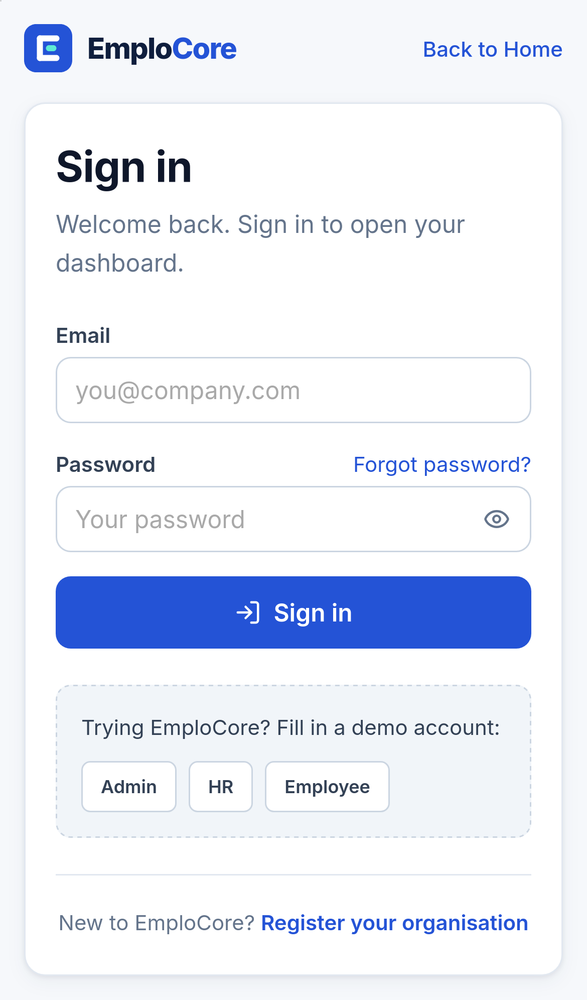
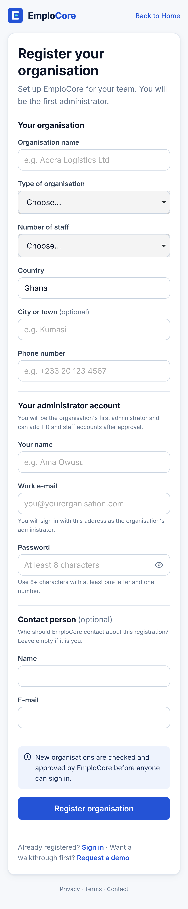
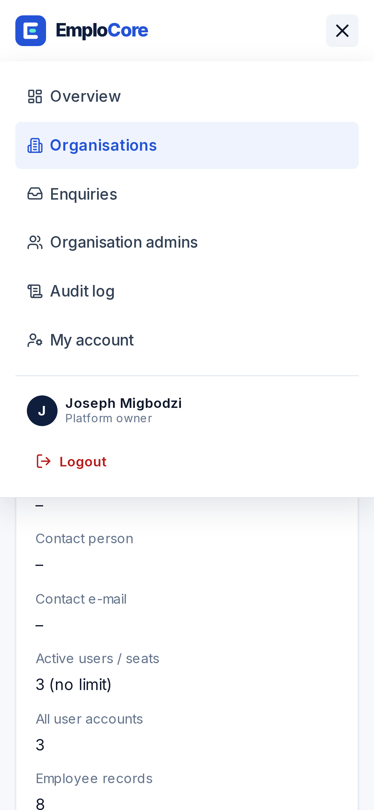
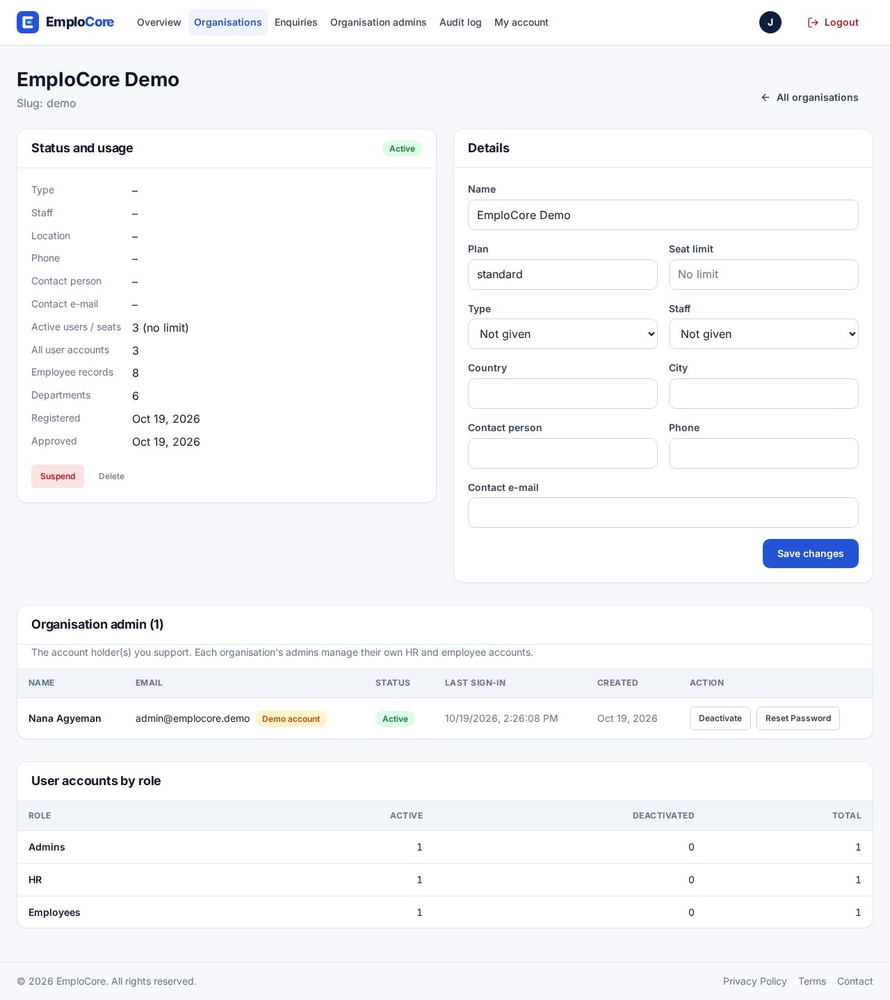
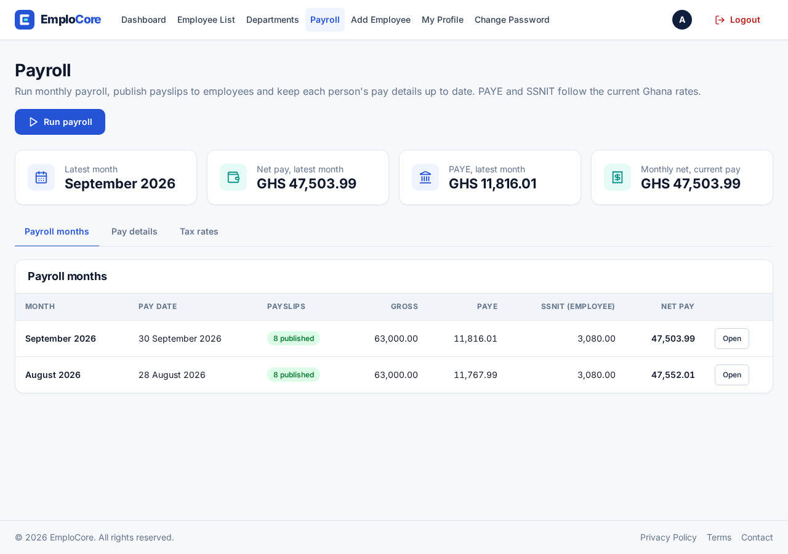
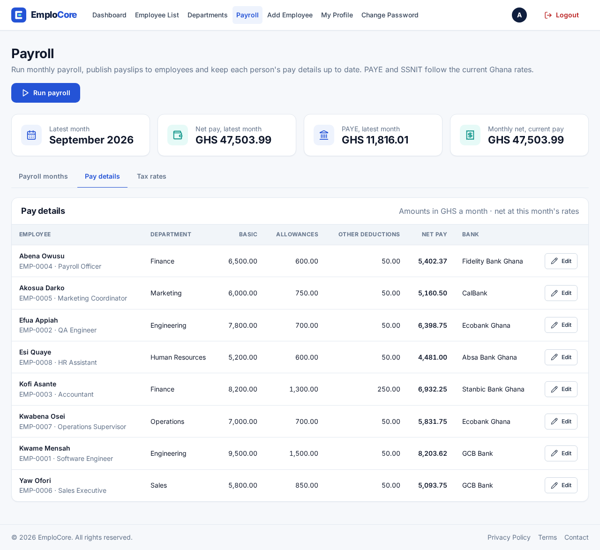
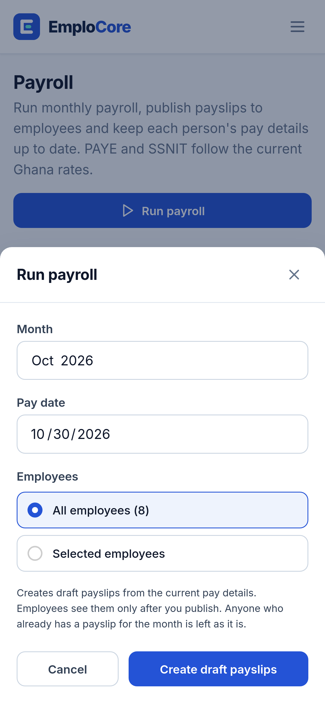
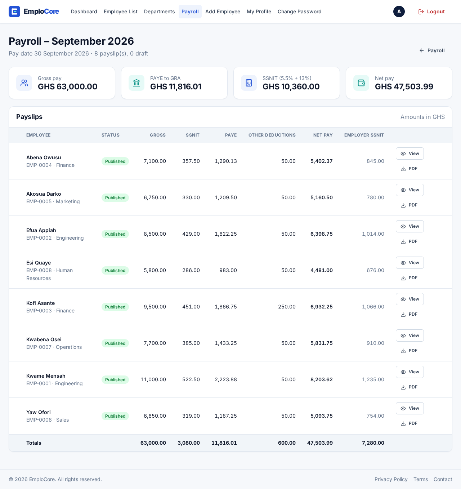
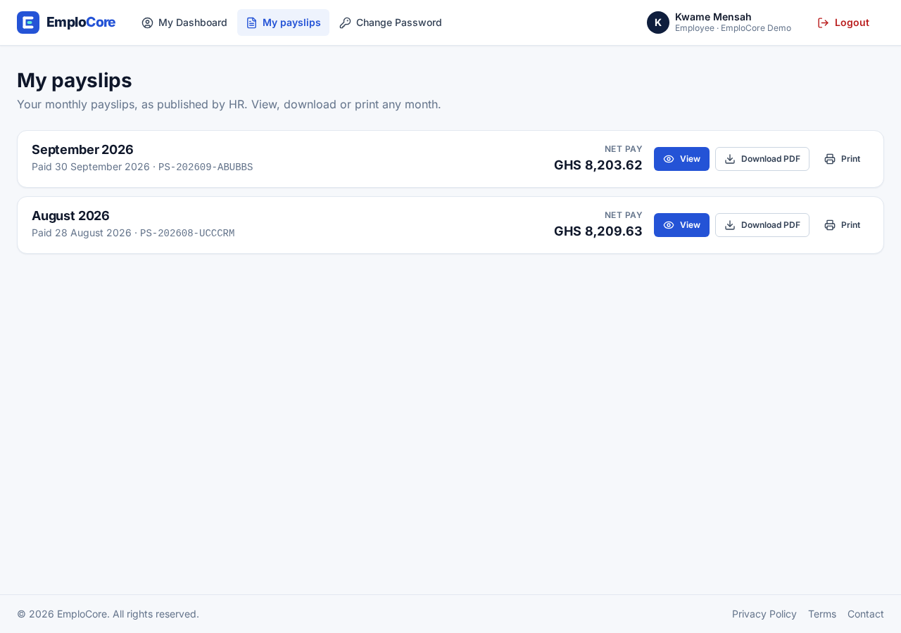
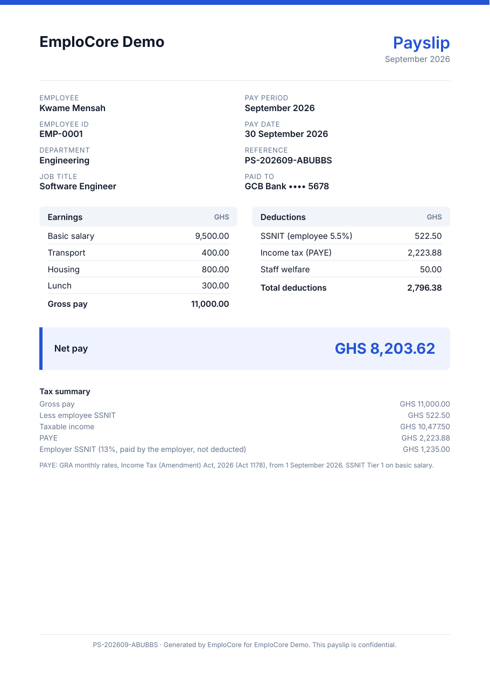

# 10. User guides by role

Screens are from the live demo ("EmploCore Demo"). Button names are written in **bold** exactly as
they appear. On phones, open the menu with the menu button at the top right.

## Getting an organisation started

1. Go to **Register your organisation** (`/register-organisation`), fill in the organisation details
   and your administrator account, and press **Register organisation**.
2. You will see "Registration received". You cannot sign in until EmploCore (the owner) approves the
   organisation; trying shows "waiting for approval".
3. Once approved, sign in at `/login`. You land on the admin dashboard.

## Owner (platform owner console, `/owner`)

Navigation: **Overview**, **Organisations**, **Enquiries**, **Organisation admins**, **Audit log**,
**My account**. Badges show how many organisations are waiting and how many enquiries are new.

### Approve or reject a new organisation

1. Open **Overview** (or **Organisations**). New registrations are listed under *Pending approval*
   with their type, size, location and contact.
2. Press **Review** to open the organisation, or act straight from the card.
3. Press **Approve**. The organisation becomes *Active* and its admin can sign in.
4. Or press **Reject**, optionally type a reason, and confirm. The admin sees the reason when they try
   to sign in. A rejected registration with no employee records can then be removed with **Delete**.

### Manage an organisation

1. **Organisations** → search or filter by status → click the organisation's name.
2. *Status and usage* shows details, active users against seats, and dates. Use **Suspend**
   (everyone in it is signed out and cannot sign in; data is kept) or **Reactivate**.
3. *Details*: change name, seat limit, type, staff size, location and contact, then press
   **Save changes**.
4. *Organisation admin*: the account holder(s), with status and last sign-in. Use **Deactivate** /
   **Activate**, or **Reset Password** → set a temporary password (shown once; they must change it
   at sign-in) or create a one-time reset link. Give the result to the admin yourself; nothing is
   e-mailed.
5. *User accounts by role*: how many admin, HR and employee accounts are active or deactivated.
   You do not see staff names; the organisation's admins manage their own people.

6. *Subscription*: plan, status, trial or renewal date, amount, discount, last payment and payments.
   **Extend trial** (1–90 days), **End trial now**, **Record payment** (cash, mobile money or bank
   transfer: plan, months, amount, reference, date and note; the admin gets a paid invoice), **Pause** /
   **Resume**, **Cancel subscription** (now, or at the end of a paid period), **Assign plan** (any plan including Enterprise, with an optional
   employee limit, agreed monthly price, number of months and an internal note; any Paystack
   subscription is stopped first) and **Apply founding discount**. Every action is recorded in the
   platform audit log. The demo organisation is exempt.

### Revenue and plans

- **Revenue → Payments settings**: whether Paystack is connected and in test or live mode, the webhook
  address to copy, when the last webhook arrived, the last daily billing run, and how to switch to live.
- **Revenue**: monthly recurring revenue, annual run rate, money collected in the last 30 days,
  organisations by status, MRR by plan and recent payments.
- **Plans and prices**: **Edit** a plan to change its prices, included employees, extra-employee
  price, account limits, features and the feature list shown on the pricing page (live within a
  minute). Switch the **founding offer** on or off.

To add a client yourself: **Organisations** → **New organisation** → organisation name,
seat limit, contact e-mail (optional) and the first administrator (name, e-mail, password optional).
If you leave the password empty, a temporary one is shown once: give the sign-in details to the admin.

### Enquiries (demo requests)

1. **Enquiries** lists every "Request a demo" message from the contact page: who, organisation,
   message and when.
2. Follow up outside the app (e-mail or phone), then press **Mark contacted**. Later use **Close**,
   or **Reopen** if needed. **Delete** removes spam.

### Organisation admins

**Organisation admins** lists every organisation's admin accounts. Search by name, e-mail or
organisation, filter by organisation or status, and use the same **Deactivate** and
**Reset Password** actions as on the organisation page.

### Audit log

**Audit log** shows platform-level events only: registrations, approvals, rejections, suspensions,
organisation edits and deletions, enquiries, and everything an owner does. Filter by organisation
and search. Routine activity inside an organisation is not shown to you.

### My account

1. **My account** → *Name and e-mail*: change the **Display name**; changing the
   **E-mail (used to sign in)** asks for your **Current password**.
2. *Change password*: current password, new password (12+ characters, a letter and a number, not
   containing your e-mail name) and confirmation.

## Organisation admin (`/admin`)

Navigation: **Dashboard**, **View Users**, **User Management**, **Audit Log**, **Departments**,
**Payroll**, **Billing**, **HR Dashboard**, **Change Password**. Admins can also do everything HR can.

### Create accounts

1. **Dashboard** → **Create New User** → username, e-mail, password, role (Employee, HR or Admin).
2. Tell the person their sign-in details. If the organisation has a seat limit and it is full, you
   will see a message: deactivate an account or ask EmploCore to raise the limit.

### Manage accounts

1. **User Management** lists every account in your organisation.
2. **Change Role** to switch between employee, HR and admin (not for yourself).
3. **Deactivate** / **Activate**: a deactivated person is signed out at once and cannot sign in.
4. **Reset Password**: a temporary password (shown once, **Copy** it) or a one-time reset link.
5. **Delete** removes the account (its employee record, if linked, is kept and unlinked).
6. **View Users** is a read-only list with search and a role filter, showing which accounts are
   linked to an employee record.

### Billing

**Billing** (admins only) shows your plan, its status (free trial, active, grace period or Free), the
trial or renewal date, usage against the plan's limits, and your payment history with PDF invoices.

1. To choose or change a plan: pick **Monthly** or **Yearly**, then **Choose …** on a plan. You pay on
   Paystack's secure page (card or mobile money) and come back to a confirmation page.
2. **Cancel renewal** keeps the plan until the end of the period you paid for; **Update card** opens
   Paystack's card page.
3. If a payment fails, you get a 7-day grace period (shown as a red banner), then the organisation
   moves to Free. Nothing is deleted: records over a limit become read-only until you upgrade.
4. If online payment is not switched on yet, the page says **Payments coming soon, contact us**: use
   the contact page and EmploCore will set up your plan.

New organisations get a 30-day Growth trial with no card. The demo organisation is never billed.

### Audit log

**Audit Log** (Growth plan and above) shows everything that happened in your organisation (sign-ins, account changes,
employee, department and payroll changes, and EmploCore's actions on your organisation). Filter by
action and search the descriptions. The dashboard shows the latest entries under *Recent activity*.

## HR (`/hr`)

Navigation: **Dashboard**, **Employee List**, **Departments**, **Payroll**, **Add Employee**,
**My Profile**, **Change Password**.

### Employees

1. Set up departments first (below), so you can pick one for each person.
2. **Add Employee** → full name, e-mail (optional, unique in your organisation), phone, position,
   department, salary → **Create Employee**.
3. **Employee List**: search, **Filter by Department**, **Edit** or delete records.
4. Link a record to a login: in the *Account* column choose the person's user account. They then see
   their employment record and payslips. To create the login itself, ask an admin (the API also
   allows HR to create *employee* accounts, but there is no HR screen for it yet).

### Departments

1. **Departments** → **New department** → name and description → **Create department**.
2. Open a department to see **Members**; use **Add employees** to move people in (someone heading
   another department stops doing so), or remove them.
3. Choose the **Head of department** from its members.
4. Deactivate a department you no longer use (members stay; nobody new can join). A department can be
   deleted only when it is empty.

### Payroll

1. **Payroll** → *Pay details* → **Edit** for each employee: basic salary, allowances, other
   deductions, bank and SSNIT number. The net pay updates as you type.

   

2. **Run payroll** → choose the **Month** and **Pay date**, and **All employees** or **Selected employees** (tick the people) →
   **Create draft payslips**.

   

3. Open the month: check gross, PAYE, SSNIT and net totals and individual payslips. Use
   **Delete draft** to remove a wrong draft and run it again for that person.
4. **Publish all drafts** (or tick some and **Publish selected**). Employees can now see them.
   Published payslips cannot be changed.

   

5. *Tax rates* shows the PAYE bands and SSNIT rates in use.

## Employee (`/employee`)

Navigation: **My Dashboard**, **My payslips**, **Change Password**.

1. **My Dashboard**: your profile (first name, last name, phone, address: edit and save) and the
   employment record HR linked to you (position, department, salary).
2. **My payslips**: every published month. **View** opens the payslip with an explanation of how
   PAYE was worked out; **Download PDF** saves it; **Print** prints just the payslip on A4.
3. **Change Password**: current password and a new one (8+ characters with a letter and a number).
   Forgot it? Ask your organisation's admin for a reset.

